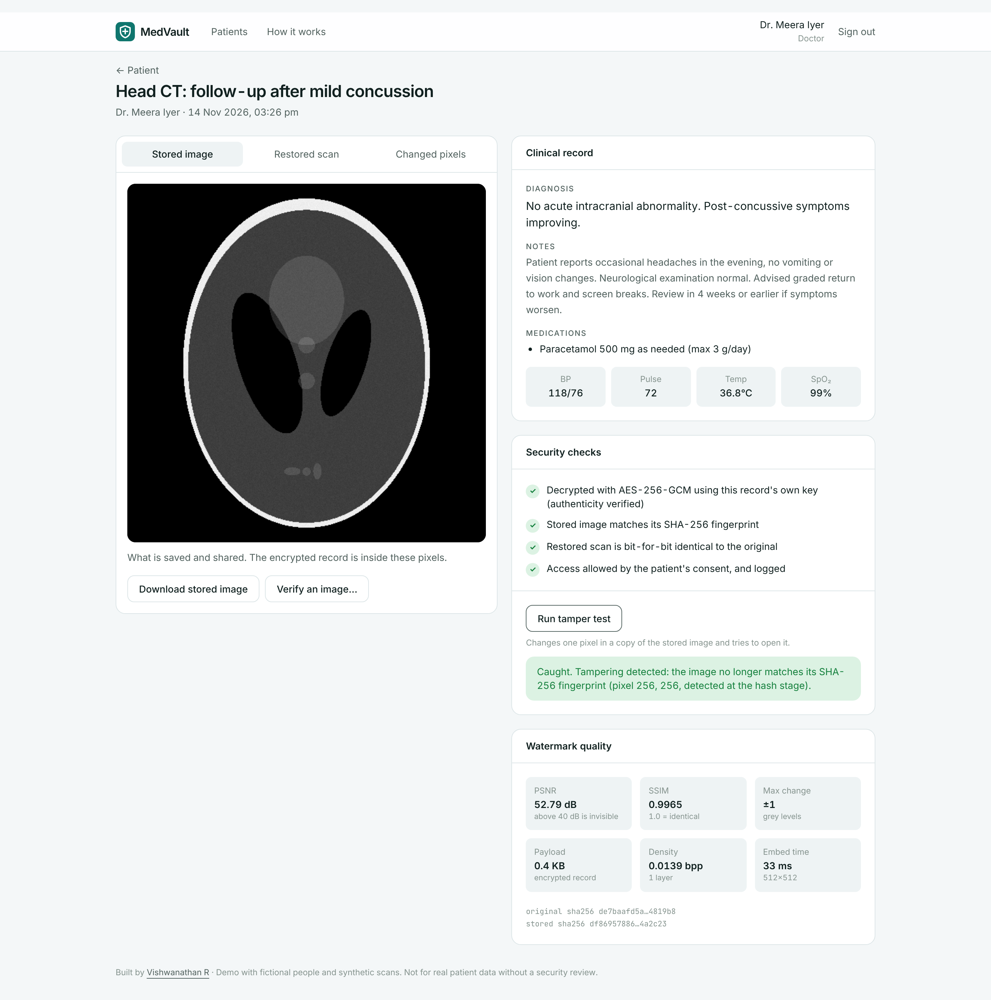
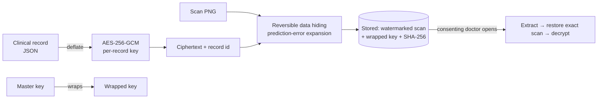
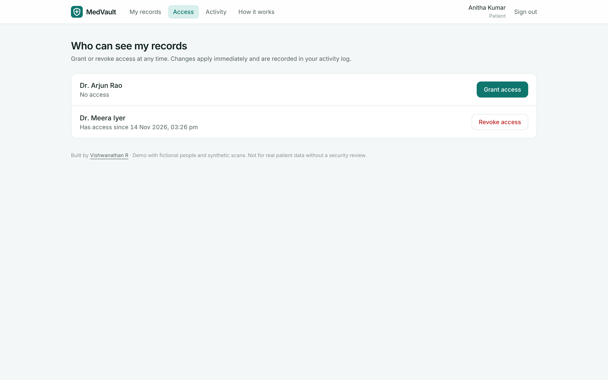
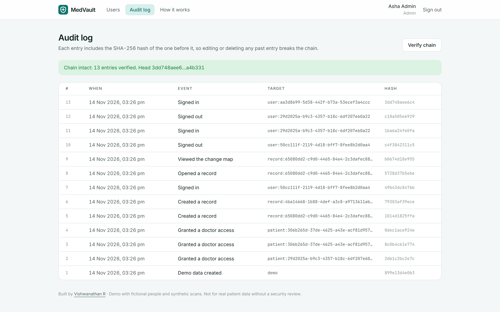
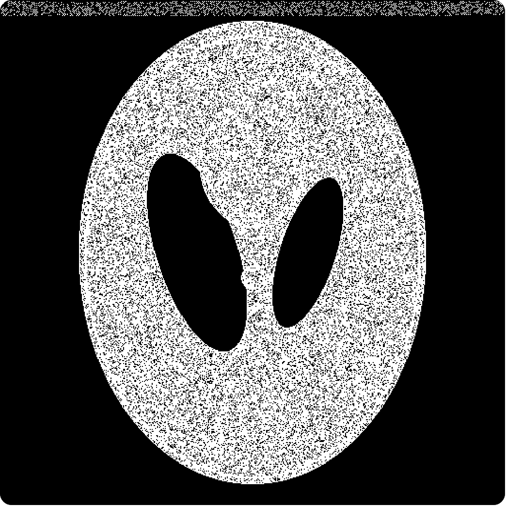
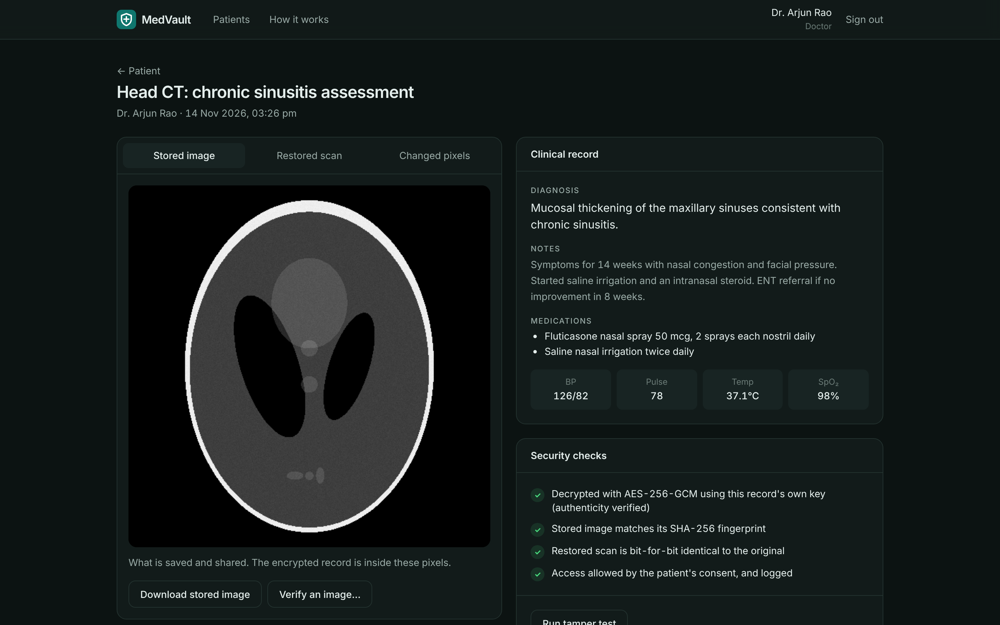

# MedVault · Privacy-preserving medical records storage

> Built by [Vishwanathan R](https://vishwanathan.dev) · [Portfolio](https://vishwanathan.dev) · [Resume](https://vishwanathan.dev/resume.pdf)

MedVault stores each medical record **encrypted inside its own scan**. The record is sealed with AES-256-GCM, then hidden in the image's pixels with **reversible watermarking**. Only doctors the patient approves can open it. When they do, the **original scan is restored bit for bit**, and every access is written to a **tamper-evident audit log**.



> Version 2 is a full rebuild in TypeScript. The original Python version (CNN predictor with histogram shifting, Streamlit) is kept on the [`v1-python`](https://github.com/Vishwanathanirv/privacy-preserving-medical-records-storage/tree/v1-python) branch.

## Why

Records and images usually live in separate systems, so a copied, emailed or archived scan loses its context. Hiding the record inside the scan keeps them together. Encryption means the image alone reveals nothing, and reversibility means the diagnostic image is never permanently altered.

## Results

From `npm run benchmark`, using synthetic Shepp–Logan CT slices:

| Image | Payload | PSNR | SSIM | Embed | Extract | Exact restoration |
| --- | --- | --- | --- | --- | --- | --- |
| 512 × 512 | 1.5 KB record | **52.6 dB** | **0.996** | 20 ms | 23 ms | ✓ |
| 1024 × 1024 | 1.5 KB record | 52.8 dB | 0.996 | 127 ms | 70 ms | ✓ |
| 512 × 512 | 20 KB (full layer) | 45.8 dB | 0.864 | 224 ms | 26 ms | ✓ |

- PSNR above 40 dB is generally invisible.
- No pixel changes by more than ±2 grey levels.
- When one pass is not enough, extra layers are stacked automatically.

## How it works



1. **Encrypt.**
   - The record is compressed and sealed with AES-256-GCM, using a fresh 256-bit key made only for that record.
   - The ciphertext is bound to its record and patient IDs, so it cannot be moved to another record.
   - That record key is then sealed with the master key (envelope encryption), and master keys can be rotated without touching any image.
2. **Hide.**
   - Prediction-error expansion with a rhombus predictor on a checkerboard (Sachnev et al., 2009), written from scratch. Each pixel is predicted from its four neighbours, prediction errors of 0 and −1 carry one bit each, and every other error shifts by one.
   - Only pixels that would actually overflow (0 or 255) are adjusted, and those adjustments are recorded in a compressed location map that travels inside the payload. So flat black CT backgrounds stay untouched.
3. **Store.**
   - Only the watermarked scan, the wrapped key and SHA-256 fingerprints are saved.
   - The database holds **no readable medical data**, which a test checks.
4. **Open.**
   - Extraction restores the original pixels exactly, and decryption verifies authenticity.
   - Any change to the image is caught, either by the hash, by the watermark structure or by the GCM tag.

## Features

- **Roles and consent:**
  - Patients grant and revoke doctors, and changes apply instantly.
  - Doctors only see consenting patients. Refused access returns 404 and is logged.
  - Admins manage accounts but **cannot read records** (separation of duties).
- **Record viewer** with three views: the stored image, the restored scan and a map of changed pixels. It also shows security checks, image-quality metrics, a one-click **tamper test** and **image verification**: upload any PNG to see whether it carries an authentic, unmodified record.
- **Tamper-evident audit log.** Every entry includes the SHA-256 hash of the one before it, so editing or deleting history breaks the chain at the exact entry. Patients see who accessed their records, and admins can verify the whole chain.
- **Security:**
  - scrypt password hashing, signed http-only SameSite=Strict session cookies, a CSRF header check and rate limits
  - Zod validation, strict security headers (helmet) and a timing-safe login
  - production refuses to start without explicit keys
- **No real data.** Synthetic CT phantoms and fictional demo users.

| Patient-controlled access | Tamper-evident audit log |
| --- | --- |
|  |  |

| Changed pixels (±1–2 grey levels) | Dark mode |
| --- | --- |
|  |  |

## Run it

You need Node 22.13 or newer.

```bash
git clone https://github.com/Vishwanathanirv/privacy-preserving-medical-records-storage.git
cd privacy-preserving-medical-records-storage
npm install
npm run build && npm start      # http://localhost:8080
```

Sign in with one of the demo accounts on the login page (password `medvault-demo`).

For development with hot reload, run `npm run dev`. It starts the API on port 8080 and the web app on 5175.

In development, keys are generated in `./data`. In production, set them explicitly:

```bash
docker build -t medvault .
docker run -p 8080:8080 -v medvault:/data \
  -e MASTER_KEY=$(openssl rand -base64 32) -e SESSION_SECRET=$(openssl rand -base64 32) -e DEMO_SEED=off medvault
```

## Tests

```bash
npm run lint && npm run typecheck
npm test         # 25 tests
npm run benchmark
```

What the tests check:
- exact round trips at several sizes, multi-layer embedding, saturated pixels, PNG round trips and clean refusal on images with no capacity
- encryption binding, tamper detection and key rotation
- audit-chain edits and deletions
- the access-control matrix, consent grant and revoke, no plaintext in the database, tamper tests and stego-image verification

## Roadmap

- 16-bit DICOM support, using the same algorithm with a wider range
- Per-doctor key wrapping, so a doctor's own key is needed to decrypt
- Hardware or managed key storage for the master key (KMS or HSM)

## Tech stack

TypeScript · Node.js 22 · Fastify · node:sqlite · AES-256-GCM (node:crypto) · jose · Zod · pngjs · React 19 · Vite · Tailwind CSS 4 · Vitest · Docker · GitHub Actions

## License

MIT © Vishwanathan R
