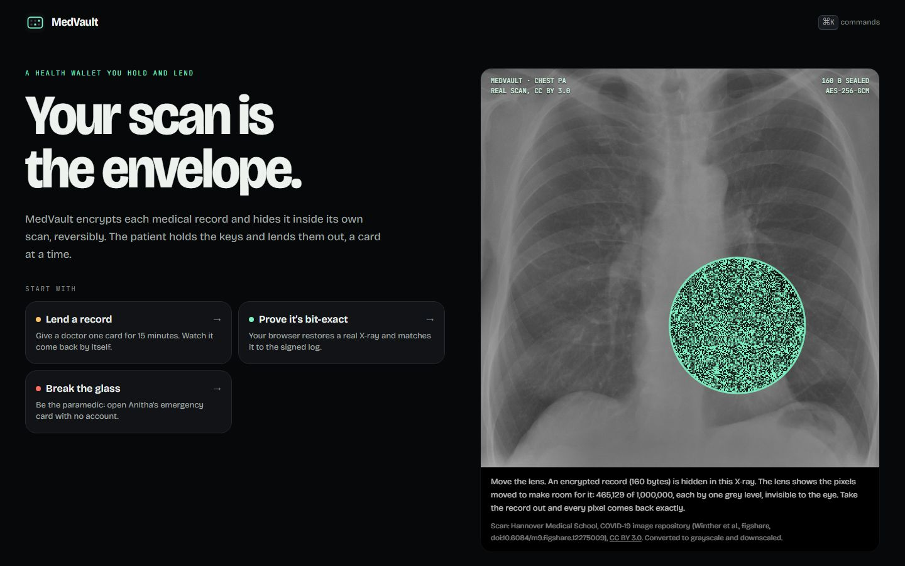
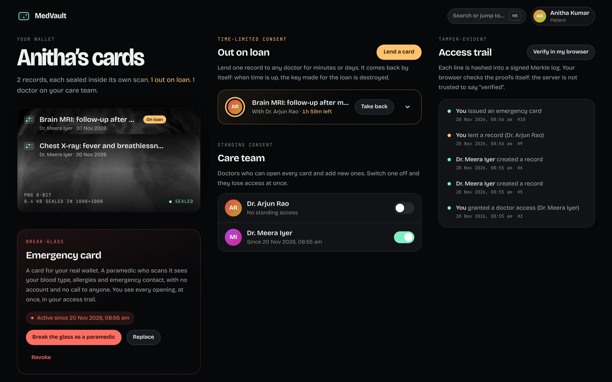
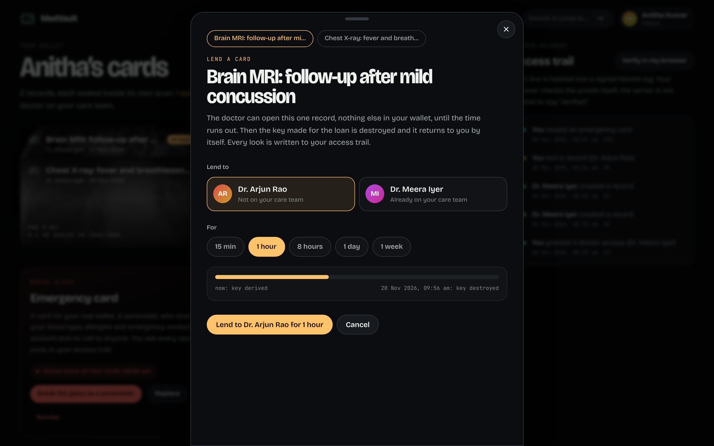
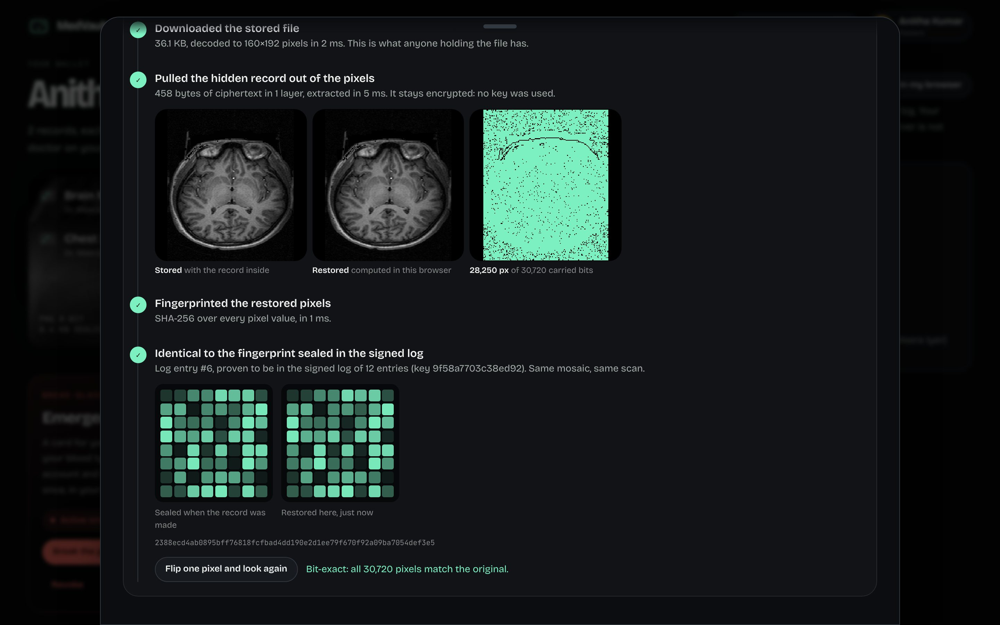
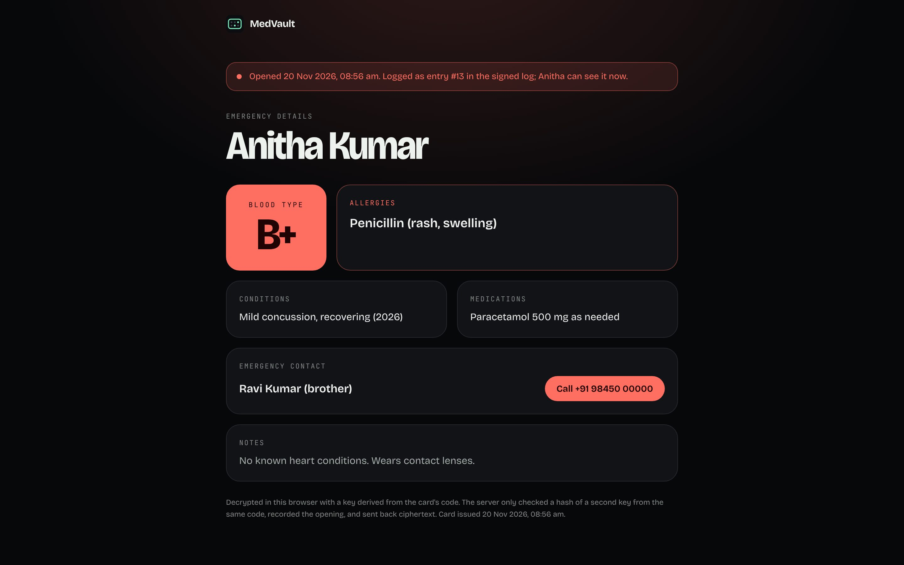
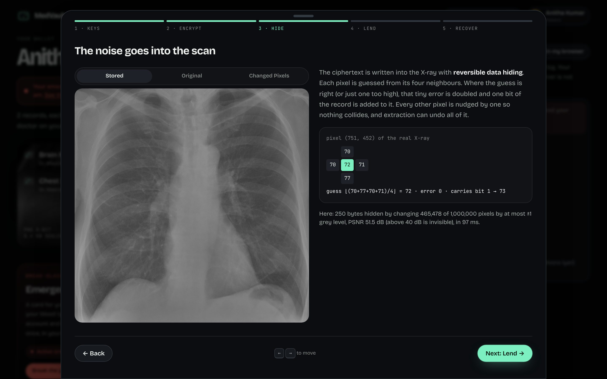
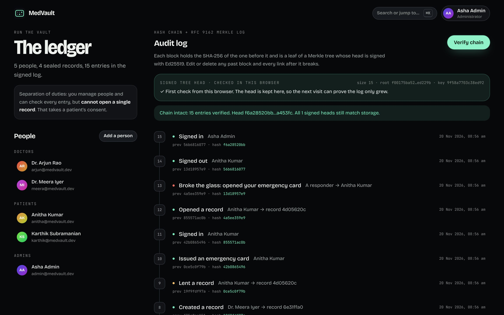
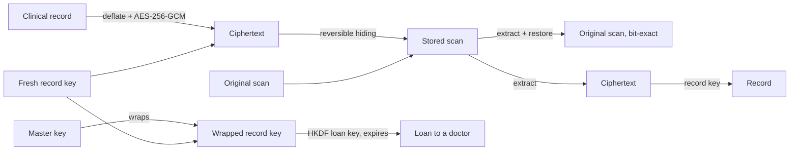

# MedVault · Your scan is the envelope



**Live demo: [medvault-five-pi.vercel.app](https://medvault-five-pi.vercel.app)**. It runs entirely in your browser, with no account and no backend.

## The idea

- **The problem.** Medical records and medical images live in different systems. Copies drift apart and leak, the context of a scan gets lost when it is emailed or archived, and patients never see who looked.
- **The idea.** Encrypt each record and hide it inside its own scan, *reversibly*. The scan carries its record wherever it goes, only the right key can read it, and taking the record out gives back the original scan to the last bit. The patient holds the keys, like cards in a wallet, and lends them out one at a time.
- **Why it's different.** Patient portals and PACS keep the keys and the logs to themselves. In MedVault, access is a loan that expires by itself, emergency access needs nothing but a card in your pocket, and every claim (who looked, that a scan is unaltered) is checked in your own browser against a signed log, not taken on the server's word.

## Signature features, and where to try them

| Feature | What it does | Try it in the live demo |
| --- | --- | --- |
| **Lend a record** (time-limited consent) | A patient lends *one* record to any doctor for 15 minutes to a week. The loan gets its own key (HKDF over the master key, bound to record, patient, doctor and expiry), and the record key is re-wrapped under it. When time runs out, or the patient takes it back, that wrapped key is destroyed. Moving the expiry in the database does not extend the loan: the derived key no longer opens anything. | First screen → **Lend a record**, or as Anitha: **Lend a card** / the **Lend** button on any card / press `l`. As Dr. Arjun Rao: **Lent to you**, with a live countdown. |
| **Tamper-evident access trail** | Every access, loan, refusal and break-glass opening is a block in a SHA-256 hash chain *and* a leaf of an RFC 9162 Merkle tree whose head is signed with Ed25519. Patients prove their entries are in the signed log, in the browser; admins verify the chain and that the log only grew. Each loan has its own trail. | As Anitha: **Access trail → Verify in my browser**, or open a loan ticket → **Prove it in my browser**. As Asha Admin: **The ledger → Verify chain**. |
| **Prove it's bit-exact** | Your browser downloads the stored file, extracts the hidden (still encrypted) record, restores the scan, fingerprints it, and checks the fingerprint against the one sealed into the signed log when the record was made. Flip one pixel and watch the hash mosaic break. | First screen → **Prove it's bit-exact**; any record → **Prove it's bit-exact**; or press `p`. |
| **Emergency break-glass card** | A wallet-sized card with a QR code. The patient's browser makes a 100-bit code and stretches it with scrypt into two keys: one seals the summary (blood type, allergies, conditions, medications, contact), the other proves possession. The server stores only ciphertext and a hash, so it can log every opening but never read the card. A responder needs no account. The patient is alerted at once. | First screen → **Break the glass**; as Anitha: **Emergency card → Break the glass as a paramedic**, or **Replace** to issue, print and try a new one. |
| **How it works** | An interactive walkthrough that follows one real X-ray and record through keys → encryption → reversible hiding → lending → recovery, all computed live. | First screen → **How it works**, or press `h` anywhere. |

Also: patients switch doctors on their **care team** on and off (standing consent); DICOM files are **de-identified** (identifying header values travel only inside the encrypted record, and the original file is rebuilt byte for byte); a one-click **tamper test**; **file verification** for any PNG or DICOM; a **command palette** (`⌘K` / `Ctrl K` or `/`).

| Wallet | Lending |
| --- | --- |
|  |  |
| **Bit-exact proof** | **Break-glass** |
|  |  |
| **How it works** | **The ledger (admin)** |
|  |  |

## How it works



1. **Keys.** Every record gets a fresh 256-bit key, wrapped with the master key (envelope encryption), so the master key can rotate without touching a scan. Loans derive their own keys with HKDF-SHA256; the emergency card's keys come from scrypt over a code only the patient holds. No key is reused.
2. **Encrypt.** The record is compressed and sealed with AES-256-GCM (random 96-bit nonce, 128-bit tag), bound to its record and patient ids so it cannot be moved to another scan. Titles, which lists need, are sealed separately under the master key, so the database holds no readable clinical text.
3. **Hide.** Prediction-error expansion with a rhombus predictor on a checkerboard (Sachnev et al., 2009), written from scratch: each pixel is predicted from its four neighbours; errors of 0 and −1 carry one bit each, and every other pixel shifts by one. Overflow is handled with a compressed location map that travels inside the payload. It works at any bit depth up to 16, with a wider expansion band chosen per layer for noisy high-bit-depth scans.
4. **Share.** Care-team doctors open records through the master-wrapped key; a loan opens one record through its own wrapped copy until it is destroyed. Every access goes into the signed log.
5. **Recover and verify.** Extraction restores the original pixels exactly; decryption checks authenticity. The browser can redo the recovery itself and match the pixels' SHA-256 to the fingerprint sealed in the signed log.

## Security

What protects what, and what I fixed during the review:

- **Encryption**: AES-256-GCM everywhere (authenticated), random nonces, one key per record, per loan and per card. Ciphertexts are bound to their context with associated data.
- **Key derivation**: passwords use scrypt (N = 2^15, r = 8, p = 1) with constant-time comparison and a dummy hash for unknown emails; loan keys use HKDF-SHA256; card codes have 100 bits of entropy *and* go through scrypt.
- **Access control**: patients see their own data, doctors only consenting patients or a record on loan, admins no clinical data (separation of duties). Refusals return 404 and are logged.
- **Review fixes** (each has a test): record titles were stored in plaintext and are now sealed; ids are validated as UUIDs (a crafted record id could plant "denied" entries in another patient's activity feed); malformed JSON returns 400 instead of 500; demo password hashing now uses the server's scrypt cost; PSNR and SSIM for 16-bit images used the container's 65535 peak and overstated quality by over 30 dB; ended loan keys are zeroed on disk (SQLite `secure_delete`); vulnerable dependencies upgraded (`npm audit`: 0).
- **Headers**: strict CSP (self only, no inline script), HSTS, nosniff, no-referrer, COOP, Permissions-Policy; on the server also signed http-only SameSite=Strict session cookies, a CSRF header check and rate limits (login and break-glass at 10/min).
- **Limits, honestly**: the server holds the master key, so lending and consent are enforced by the server (and made tamper-evident by the log), not by the patient's own key. In the browser demo, everything, including that key, lives in your browser's storage; that is fine for a sandbox and is exactly why a real deployment keeps keys on the server. Sessions are stateless JWTs that expire after 8 hours rather than being revocable. This is a portfolio project; real patient data would need a professional security review.

## Measurements

From `npm run benchmark` on real, openly licensed scans (full table, environment and capacity: [docs/measurements.md](docs/measurements.md); sources and licences: [samples/README.md](samples/README.md)):

| Image (real, licensed) | Payload | PSNR | SSIM | Max change | Embed | Extract | Capacity (6 layers) |
| --- | --- | ---: | ---: | ---: | ---: | ---: | ---: |
| Chest X-ray, 1000×1000, 8-bit | sealed record, 393 B | 51.4 dB | 0.995 | ±1 | 306 ms | 54 ms | 240,779 B (1.93 bpp) |
| Chest X-ray, 1000×1000, 8-bit | 8 KB | 51.1 dB | 0.994 | ±1 | 325 ms | 56 ms | |
| Second chest X-ray, 1000×1000 | full first layer, 63,108 B | 45.9 dB | 0.992 | ±1 | 57 ms | 62 ms | 243,163 B (1.95 bpp) |
| Brain MRI, 160×192, 16-bit (10 used) | sealed record, 393 B | 52.3 dB | 0.997 | ±4 | 53 ms | 3 ms | 2,780 B (0.72 bpp) |
| Brain MRI, 160×192, 16-bit (10 used) | full first layer, 1,837 B | 34.1 dB | 0.849 | ±35 | 255 ms | 15 ms | |

PSNR is against each image's actual peak; median of 5 runs on one Xeon core at 2.1 GHz. A small, noisy, high-bit-depth MRI slice pays for capacity in distortion, which the table shows rather than hides.

Every run restores the original pixels bit for bit and returns the exact payload.

## Run it

You need Node 22.13 or newer.

```bash
npm install
npm run build && npm start      # http://localhost:8080, API and app
npm run dev                     # API on 8080, app with hot reload on 5175
npm run build:demo              # the static, in-browser demo (what Vercel serves)
```

Sign in with a demo account on the first screen (password `medvault-demo`). In development, keys are generated in `./data`; in production set them explicitly:

```bash
docker build -f deploy/Dockerfile -t medvault .
docker run -p 8080:8080 -v medvault:/data \
  -e MASTER_KEY=$(openssl rand -base64 32) -e SESSION_SECRET=$(openssl rand -base64 32) \
  -e LOG_SIGNING_KEY=$(openssl rand -base64 32) -e DEMO_SEED=off medvault
```

The live demo is the same app with the same API service compiled into the page, over an in-memory database saved to `localStorage`, so each visitor gets a private sandbox. `vercel.json` builds it with no environment variables.

## Tests

```bash
npm run lint && npm run typecheck
npm test          # 53 unit and API tests
npm run test:e2e  # 9 browser tests on the demo build
npm run benchmark # writes docs/measurements.md
npm run samples   # re-downloads and checks the sample scans
```

They cover exact round trips at every bit depth, encryption binding and tamper detection, the audit chain and Merkle proofs (against the RFC definitions up to 70 leaves), the access-control matrix, lending (expiry, revocation, forged expiry), break-glass (no plaintext stored, wrong codes, revocation), the bit-exact proof, and in the browser every feature end to end.

## Tech

TypeScript · React 19 · Vite · Tailwind CSS 4 · Bricolage Grotesque and JetBrains Mono (variable) · Node.js 22 · Fastify · node:sqlite · @noble/ciphers, @noble/hashes, @noble/curves (AES-GCM, HKDF, scrypt, Ed25519) · fast-png · fflate · Zod · Vitest · Playwright

## Licence

MIT. Sample images keep their own licences (CC BY 3.0 and CC0), listed in [samples/README.md](samples/README.md).
