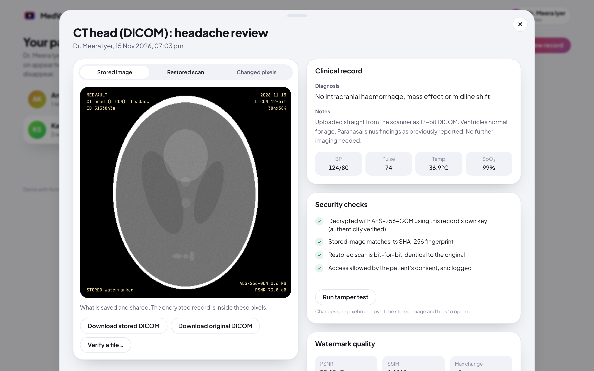
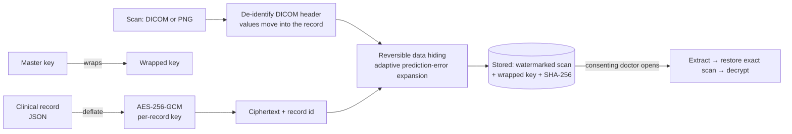
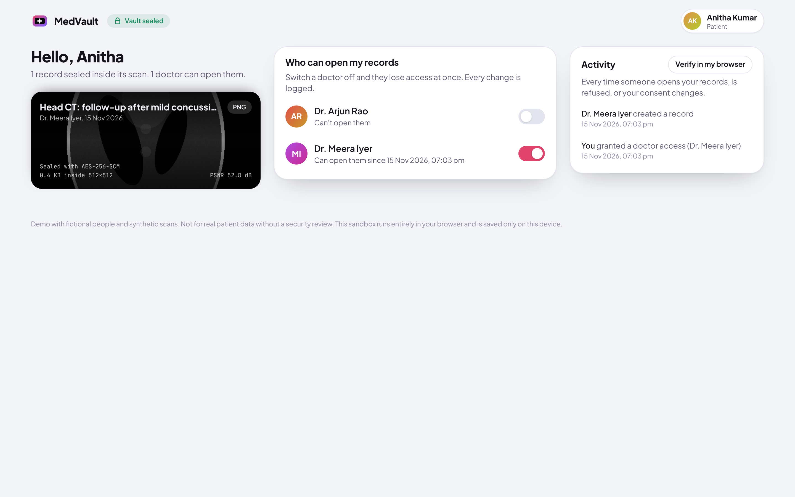
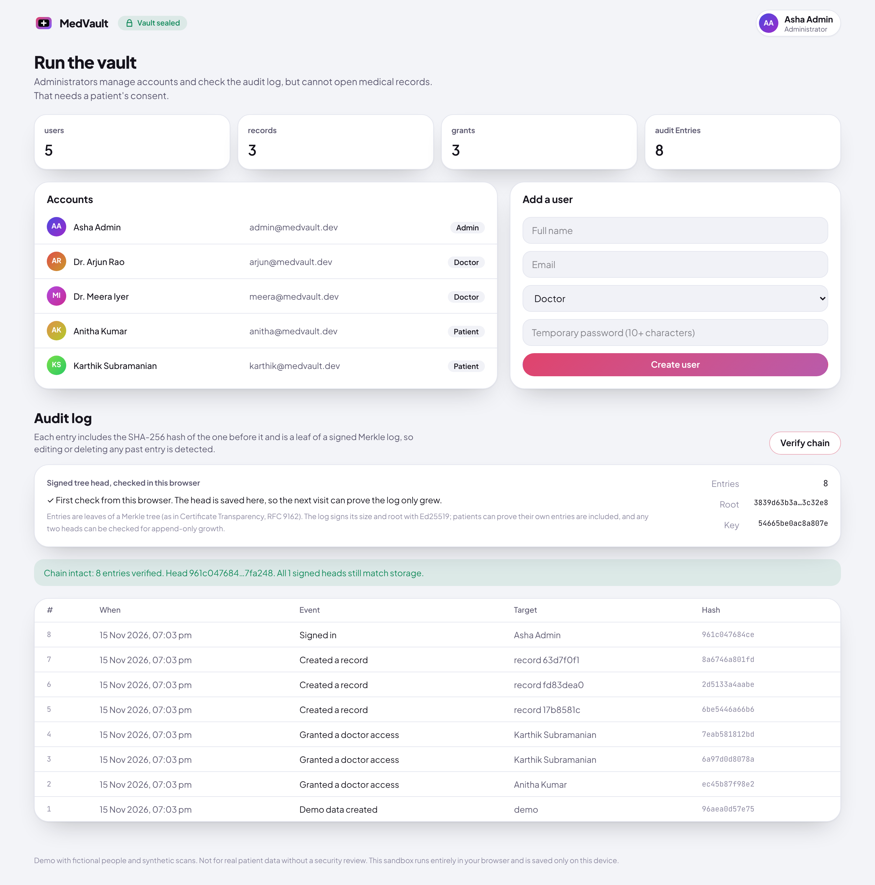
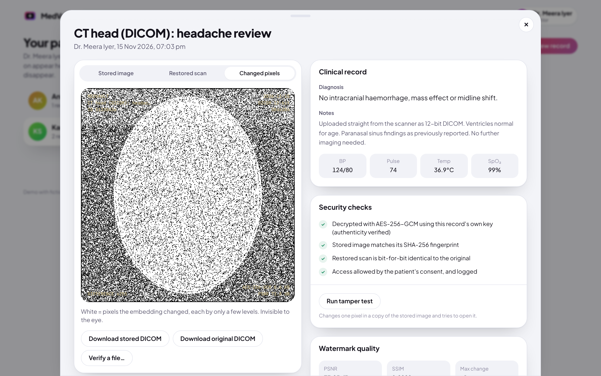
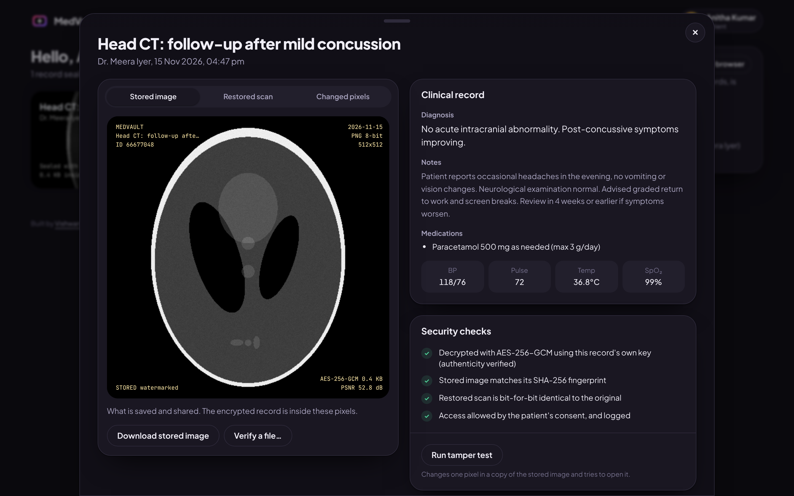

# MedVault · Privacy-preserving medical records storage


MedVault stores each medical record **encrypted inside its own scan**. The record is sealed with AES-256-GCM, then hidden in the image's pixels with **reversible watermarking**. It works on **real DICOM files from scanners (12 and 16-bit CT, MR, X-ray)** as well as PNG. Only doctors the patient approves can open a record. When they do, the **original file is restored byte for byte**, and every access is written to a **signed, Merkle-tree transparency log** that patients can verify in their own browser.



> Version 2 is a full rebuild in TypeScript. The original Python version (CNN predictor with histogram shifting, Streamlit) is kept on the [`v1-python`](https://github.com/Vishwanathanirv/privacy-preserving-medical-records-storage/tree/v1-python) branch.

## Why

Records and images usually live in separate systems, so a copied, emailed or archived scan loses its context. Hiding the record inside the scan keeps them together. Encryption means the image alone reveals nothing, and reversibility means the diagnostic image is never permanently altered.

## Results

From `npm run benchmark`, using synthetic Shepp–Logan CT slices:

| Image | Payload | PSNR | SSIM | Embed | Extract | Exact restoration |
| --- | --- | --- | --- | --- | --- | --- |
| 512 × 512 | 1.5 KB record | **52.6 dB** | **0.996** | 20 ms | 23 ms | ✓ |
| 1024 × 1024 | 1.5 KB record | 52.8 dB | 0.996 | 127 ms | 70 ms | ✓ |
| 512 × 512 | 20 KB (full layer) | 45.8 dB | 0.864 | 224 ms | 26 ms | ✓ |

- PSNR above 40 dB is generally invisible.
- No pixel changes by more than ±2 grey levels.
- When one pass is not enough, extra layers are stacked automatically.

**DICOM** (12 and 16-bit stored values, PSNR relative to the image's own peak):

| Image | Payload | PSNR | Max change | Threshold | Exact restoration of the file |
| --- | --- | --- | --- | --- | --- |
| 12-bit CT, 512 × 512 (synthetic) | 1.6 KB | **73.8 dB** | ±1 HU | T = 1 | ✓ byte for byte |
| 12-bit CT, 512 × 512 (synthetic) | 8 KB | 73.2 dB | ±1 HU | T = 1 | ✓ |
| Real 16-bit CT, 128 × 128 (pydicom's `CT_small.dcm`) | 400 B | 82.0 dB | ±6 HU | T = 6 | ✓ |

Real scanner data is noisy at 16 bits, so a pixel's prediction error is rarely exactly 0 or −1 and classic expansion carries almost nothing (121 of 400 bytes fit in the real slice above). MedVault expands every error in [−T, T−1] instead and picks the smallest T that fits, per layer. T stays at 1 for 8-bit images, and existing records still decode.

## How it works



1. **Encrypt.**
   - The record is compressed and sealed with AES-256-GCM, using a fresh 256-bit key made only for that record.
   - The ciphertext is bound to its record and patient IDs, so it cannot be moved to another record.
   - That record key is then sealed with the master key (envelope encryption), and master keys can be rotated without touching any image.
2. **Hide.**
   - Prediction-error expansion with a rhombus predictor on a checkerboard (Sachnev et al., 2009), written from scratch. Each pixel is predicted from its four neighbours, prediction errors of 0 and −1 carry one bit each, and every other error shifts by one.
   - Only pixels that would actually overflow are adjusted, and those adjustments are recorded in a compressed location map that travels inside the payload. So flat black CT backgrounds stay untouched.
   - Works at any bit depth up to 16. For noisy high-bit-depth scans the expansion band widens to [−T, T−1], with T chosen per layer and stored in that layer's header.
   - **DICOM:** a from-scratch Part 10 reader (explicit and implicit VR little endian, nested sequences, signed pixels, Bits Stored below Bits Allocated). Pixels are rewritten in place, so no other byte of the file moves. Identifying attributes (a subset of the PS3.15 Basic Profile: name, ID, birth date, address, institution, physicians, accession number...) are blanked in the stored file and travel only inside the encrypted record, so a stolen stored file names nobody, and the original file is rebuilt exactly for an authorised download. Compressed transfer syntaxes and multi-frame files are rejected with a clear message.
3. **Store.**
   - Only the watermarked scan, the wrapped key and SHA-256 fingerprints are saved.
   - The database holds **no readable medical data**, which a test checks.
4. **Open.**
   - Extraction restores the original pixels exactly, and decryption verifies authenticity.
   - Any change to the image is caught, either by the hash, by the watermark structure or by the GCM tag.

## Features

- **A health wallet, not a dashboard.** Records are cards you flip through, and each card's art is the scan the record is sealed inside. Opening one slides it up as a sheet. There is no menu bar: each person gets one home screen with everything they can do. Patients see their wallet, a switch for each doctor and their activity feed. Doctors see their patients as contacts, with the selected patient's wallet. Admins see accounts and the audit log. Everything else sits behind the avatar menu. Plus Jakarta Sans, light and dark, and it works on a phone.
- **Roles and consent:**
  - Patients grant and revoke doctors, and changes apply instantly.
  - Doctors only see consenting patients. Refused access returns 404 and is logged.
  - Admins manage accounts but **cannot read records** (separation of duties).
- **Record viewer** with three views: the stored image, the restored scan and a map of changed pixels (DICOM shown with its own display window). It also shows security checks, image-quality metrics, a one-click **tamper test** and **file verification**: upload any PNG or DICOM file to see whether it carries an authentic, unmodified record. DICOM records can be downloaded as the stored, de-identified file or as the restored original (logged).
- **Transparency log.** Every audit entry is hash-chained to the one before it *and* is a leaf of a Merkle tree built to RFC 9162 (the design behind Certificate Transparency). The log signs its size and root with Ed25519. In the browser, with no trust in the server:
  - a patient proves that each access entry they are shown is in the signed log (an inclusion proof of log₂ n hashes), so the server cannot show them a different history from everyone else;
  - an admin's browser keeps the last signed head it saw and, on the next visit, checks a consistency proof that the log only grew, so no past entry was edited or removed in between;
  - the server re-checks every head it has signed against the log rebuilt from storage, so a row edited directly in the database is caught.
  The tree, the proofs and their verification are written from scratch and tested against the RFC definitions for every size up to 70 leaves.
- **Security:**
  - scrypt password hashing, signed http-only SameSite=Strict session cookies, a CSRF header check and rate limits
  - Zod validation, strict security headers (helmet) and a timing-safe login
  - production refuses to start without explicit keys
- **No real data.** Synthetic CT phantoms and fictional demo users.

| Patient-controlled access | Transparency log |
| --- | --- |
|  |  |

| Changed pixels (±1–2 grey levels) | Dark mode |
| --- | --- |
|  |  |

## Run it

You need Node 22.13 or newer.

```bash
git clone https://github.com/Vishwanathanirv/privacy-preserving-medical-records-storage.git
cd privacy-preserving-medical-records-storage
npm install
npm run build && npm start      # http://localhost:8080
```

Sign in with one of the demo accounts on the login page (password `medvault-demo`).

For development with hot reload, run `npm run dev`. It starts the API on port 8080 and the web app on 5175.

In development, keys are generated in `./data`. In production, set them explicitly:

```bash
docker build -t medvault .
docker run -p 8080:8080 -v medvault:/data \
  -e MASTER_KEY=$(openssl rand -base64 32) -e SESSION_SECRET=$(openssl rand -base64 32) \
  -e LOG_SIGNING_KEY=$(openssl rand -base64 32) -e DEMO_SEED=off medvault
```

## Live demo on Vercel

The core (encryption, reversible embedding, PNG codec, audit chain) uses audited pure-JavaScript libraries, so it runs unchanged in Node and in the browser. `npm run build:demo` builds the web app with the real `Vault` compiled in over an in-memory database saved to `localStorage`: each visitor gets a private sandbox seeded with the fictional demo accounts, and uploaded scans never leave their machine. Import the repo on [Vercel](https://vercel.com/new) and it picks up `vercel.json`; no environment variables are needed. A real deployment with shared storage and server-held keys uses the Node server (`npm start` or Docker).

## Tests

```bash
npm run lint && npm run typecheck
npm test         # 40 tests
npm run test:e2e # browser tests on the demo build: open, verify and tamper-test a record; revoke consent; verify the audit chain
npm run benchmark
```

What the tests check:
- exact round trips at several sizes, multi-layer embedding, saturated pixels, PNG round trips and clean refusal on images with no capacity
- encryption binding, tamper detection and key rotation
- audit-chain edits and deletions
- the access-control matrix, consent grant and revoke, no plaintext in the database, tamper tests and stego-image verification

## Roadmap

- Multi-frame DICOM and replacing UIDs during de-identification
- Per-doctor key wrapping, so a doctor's own key is needed to decrypt
- Publishing signed tree heads to an outside witness, and hardware key storage (KMS or HSM)

## Tech stack

TypeScript · Node.js 22 · Fastify · node:sqlite · AES-256-GCM (@noble/ciphers) · Ed25519 (@noble/curves) · jose · Zod · fast-png · fflate · React 19 · Vite · Tailwind CSS 4 · Vitest · Docker · GitHub Actions

## License

MIT
